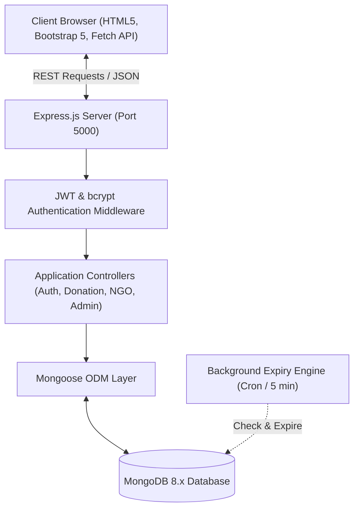
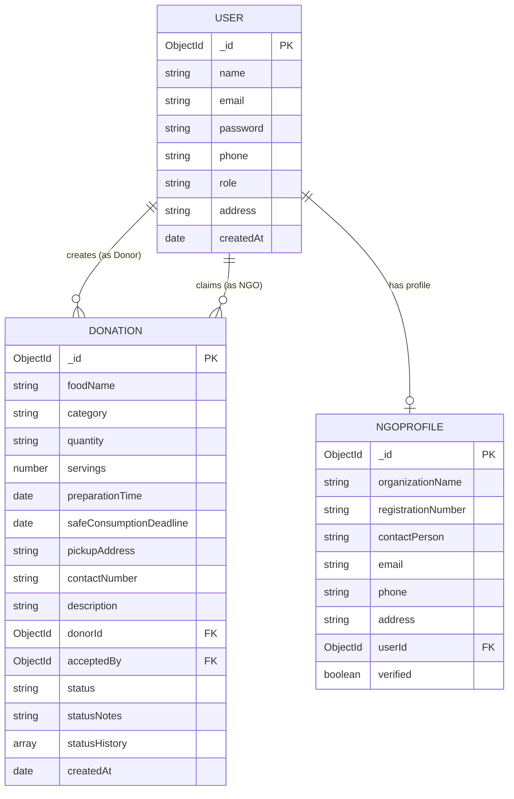
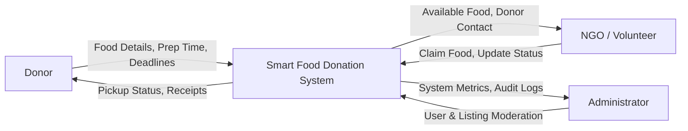
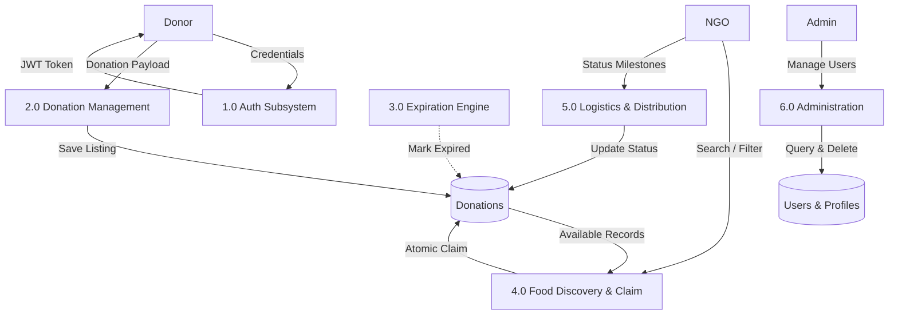
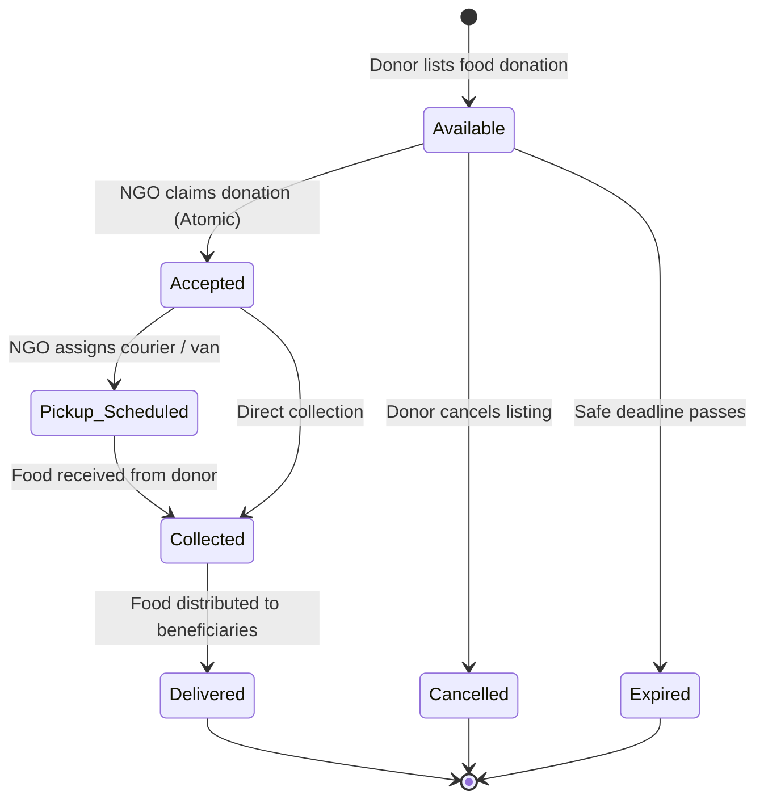

# ACADEMIC PROJECT REPORT & TECHNICAL DOCUMENTATION
## Master of Computer Applications (MCA) — Backend Technology Mini Project

---

### Project Title
# Smart Food Donation & Management System

**Domain:** Full-Stack Web Development / Social Computing / Logistics Automation  
**Core Technologies:** Node.js, Express.js, MongoDB, Mongoose, JWT, bcrypt.js, Bootstrap 5  
**Academic Level:** Master of Computer Applications (MCA)  
**Date of Submission:** 2026

---

## TABLE OF CONTENTS
1. [Abstract](#1-abstract)
2. [Introduction & Real-World Problem Formulation](#2-introduction--real-world-problem-formulation)
3. [Software Requirement Specification (SRS)](#3-software-requirement-specification-srs)
4. [System Architecture & Design Diagrams](#4-system-architecture--design-diagrams)
   - 4.1 System Architecture Diagram
   - 4.2 Entity-Relationship (ER) Diagram
   - 4.3 Data Flow Diagrams (DFD Level 0, Level 1, Level 2)
   - 4.4 State Machine Diagram (Donation Lifecycle)
5. [Database Dictionary & Schema Design](#5-database-dictionary--schema-design)
6. [Security & Concurrency Control Engineering](#6-security--concurrency-control-engineering)
   - 6.1 Role-Based Access Control (RBAC) & Middleware Pipeline
   - 6.2 Atomic Concurrency Control (Race Condition Prevention)
   - 6.3 Automated Expiration & Food Safety Engine
7. [RESTful API Specifications & Contracts](#7-restful-api-specifications--contracts)
8. [Software Testing Plan & Traceability Matrix](#8-software-testing-plan--traceability-matrix)
9. [Viva Voce & Technical Defense Q&A](#9-viva-voce--technical-defense-qa)
10. [Conclusion & Future Enhancements](#10-conclusion--future-enhancements)

---

## 1. Abstract

Urban metropolitan centers face an alarming socio-economic paradox: immense quantities of prepared, edible, and hygienic surplus food are discarded daily into landfills by hotels, banquet halls, caterers, and institutions, while millions of economically vulnerable citizens suffer from severe food deprivation. The core barrier preventing food recovery is the absence of an immediate, accountable digital coordination channel combined with the strict time-perishability of cooked meals.

The **Smart Food Donation & Management System** is a full-stack, real-world web application engineered to bridge this gap. Developed using **Node.js, Express.js, MongoDB, and Mongoose**, the system features a three-tier Role-Based Access Control (RBAC) architecture separating **Donors**, **NGOs/Volunteers**, and **System Administrators**. It features **atomic concurrency control** to prevent race conditions during donation acceptance, an **automated background expiration engine** enforcing food safety protocols, and real-time MongoDB aggregations tracking social impact metrics such as total meals distributed and beneficiaries served.

---

## 2. Introduction & Real-World Problem Formulation

### 2.1 Problem Statement
According to humanitarian food studies:
- Up to **30-40% of food prepared at social gatherings, weddings, and hotels is discarded**.
- Traditional food redistribution relies on ad-hoc phone calls or manual volunteer searches, which often fail because cooked meals spoil within 6 to 12 hours.
- Lack of transparency, delayed logistics, and fear of food contamination discourage corporate donors from participating.

### 2.2 Objectives
1. **Zero-Friction Listing:** Enable donors to list surplus food within 60 seconds with exact quantities, servings, preparation times, and safety deadlines.
2. **Atomic Food Recovery:** Provide registered NGOs with real-time location-based search and atomic claiming to ensure no two NGOs attempt pickup of the same food.
3. **Food Safety Enforcement:** Implement an automated expiration engine that flags past-deadline food as `Expired` and strictly prohibits acceptance.
4. **Transparent Handover:** Support a digital audit trail and printable **Official Transfer Slips** certifying donor hygiene and NGO collection.
5. **Impact Analytics:** Provide real-time dashboards quantifying total meals delivered, beneficiaries fed, and active logistics.

---

## 3. Software Requirement Specification (SRS)

### 3.1 Functional Requirements
- **FR1 (User Management):** Role-specific registration and authentication for Donors, NGOs (with Darpan Registration Number and Organization Name), and Administrators.
- **FR2 (Authentication & Security):** Cryptographic password hashing using `bcryptjs` (salt rounds = 10) and stateless session authorization via JSON Web Tokens (JWT).
- **FR3 (Donation Management):** Complete CRUD capabilities for donors over their own pending donations (Create, Read, Update if Available, Cancel if Available).
- **FR4 (NGO Coordination):** Search and filter available donations by food category and location; atomic acceptance; milestone progression (`Pickup Scheduled` &rarr; `Collected` &rarr; `Delivered`).
- **FR5 (Food Safety & Expiration):** Background job and query-level validator checking `safeConsumptionDeadline < Date.now()` to mark items `Expired`.
- **FR6 (Administration):** System-wide dashboard metrics, user directory moderation, and donation lifecycle audit.

### 3.2 Non-Functional Requirements
- **NFR1 (Performance):** Average API response time under 150ms for database read operations using indexed queries.
- **NFR2 (Security):** Zero plain-text password storage; prevention against NoSQL injection via Mongoose schema sanitization; JWT expiration enforcement.
- **NFR3 (Scalability):** Stateless REST architecture allowing horizontal scaling of Express instances.
- **NFR4 (Usability):** Mobile-responsive Bootstrap 5 interface adhering to WCAG contrast standards.

---

## 4. System Architecture & Design Diagrams

### 4.1 System Architecture Diagram



### 4.2 Entity-Relationship (ER) Diagram



### 4.3 Data Flow Diagrams

#### Level 0 DFD (Context Diagram)


#### Level 1 DFD (Process Decomposition)


### 4.4 State Machine Diagram (Donation Lifecycle)



---

## 5. Database Dictionary & Schema Design

### 5.1 `users` Collection
| Field Name | Data Type | Constraints | Description |
| :--- | :--- | :--- | :--- |
| `_id` | ObjectId | Primary Key, Auto | Unique document identifier |
| `name` | String | Required, Trim, Max: 100 | Full name or company/banquet title |
| `email` | String | Required, Unique, Lowercase | Unique login credential |
| `password` | String | Required, Min: 6, `select: false` | BCRYPT hashed password (never plain text) |
| `phone` | String | Required, Trim | Primary contact telephone |
| `role` | String | Required, Enum: `['donor', 'ngo', 'admin']` | Access privilege role |
| `address` | String | Required, Trim | Street / locality address |
| `createdAt` | Date | Default: `Date.now` | Account registration timestamp |

### 5.2 `ngoprofiles` Collection
| Field Name | Data Type | Constraints | Description |
| :--- | :--- | :--- | :--- |
| `_id` | ObjectId | Primary Key, Auto | Unique profile identifier |
| `organizationName` | String | Required, Trim | Registered NGO / Trust name |
| `registrationNumber`| String | Required, Unique, Trim | Government registration / Darpan ID |
| `contactPerson` | String | Required, Trim | Authorized officer in charge |
| `userId` | ObjectId | Required, Unique, Ref: `User` | Foreign key referencing `users._id` |
| `verified` | Boolean | Default: `true` | Platform verification status |

### 5.3 `donations` Collection
| Field Name | Data Type | Constraints | Description |
| :--- | :--- | :--- | :--- |
| `_id` | ObjectId | Primary Key, Auto | Unique donation identifier |
| `foodName` | String | Required, Trim | Descriptive food title |
| `category` | String | Required, Enum: 8 Categories | Classification of food |
| `quantity` | String | Required, Trim | Measure (e.g. `25 kg`, `50 boxes`) |
| `servings` | Number | Required, Min: 1 | Number of people food can feed |
| `preparationTime` | Date | Required | Cooking or packaging timestamp |
| `safeConsumptionDeadline` | Date | Required | Safety cutoff timestamp |
| `pickupAddress` | String | Required, Trim | Detailed pickup location |
| `contactNumber` | String | Required, Trim | Phone number for logistics |
| `donorId` | ObjectId | Required, Ref: `User` | Foreign key referencing donor `users._id` |
| `acceptedBy` | ObjectId | Nullable, Ref: `User` | Foreign key referencing NGO `users._id` |
| `status` | String | Required, Enum: 7 Statuses | Current state in lifecycle |
| `statusHistory` | Array | Objects: `{ status, changedAt, note }` | Full audit milestone log |

---

## 6. Security & Concurrency Control Engineering

### 6.1 Role-Based Access Control (RBAC)
Enforced using higher-order Express middleware:
```javascript
// middleware/authMiddleware.js
const authorize = (...roles) => {
  return (req, res, next) => {
    if (!req.user || !roles.includes(req.user.role)) {
      return res.status(403).json({
        success: false,
        message: `Forbidden: Role '${req.user ? req.user.role : 'guest'}' is not authorized.`
      });
    }
    next();
  };
};
```

### 6.2 Atomic Concurrency Control (Race Condition Prevention)
When multiple NGOs attempt to accept the same surplus donation concurrently, naive read-then-write code causes race conditions (both claim the same food).  
The system prevents this through MongoDB **Atomic Filtered Updates**:
```javascript
// controllers/ngoController.js
const updatedDonation = await Donation.findOneAndUpdate(
  {
    _id: donationId,
    status: 'Available',                          // Condition 1: Must be available
    safeConsumptionDeadline: { $gt: new Date() }   // Condition 2: Must not be expired
  },
  {
    $set: {
      status: 'Accepted',
      acceptedBy: req.user._id,
      statusNotes: req.body.notes || 'Accepted for pickup'
    },
    $push: {
      statusHistory: { status: 'Accepted', changedAt: new Date(), changedBy: req.user._id }
    }
  },
  { new: true }
);

if (!updatedDonation) {
  return res.status(409).json({
    success: false,
    message: 'This donation is no longer available. It may have already been accepted or expired.'
  });
}
```

### 6.3 Automated Expiration & Food Safety Engine
1. **Just-In-Time Validation:** Every query to `/api/donations` and `/api/ngo/donations` invokes `updateExpiredDonations()`.
2. **Background Engine:** A timer executes every 5 minutes in `server.js` marking any past-deadline donation as `Expired`.
3. **Acceptance Lock:** If `safeConsumptionDeadline <= Date.now()`, the API rejects acceptance with a `400 Bad Request` and updates the record to `Expired`.

---

## 7. RESTful API Specifications & Contracts

### Summary Table of Endpoints

| Category | HTTP Method | Route URI | Access Level | Response Code |
| :--- | :--- | :--- | :--- | :--- |
| **Auth** | `POST` | `/api/auth/register` | Public | `201 Created` |
| **Auth** | `POST` | `/api/auth/login` | Public | `200 OK` |
| **Auth** | `GET` | `/api/auth/me` | Authenticated | `200 OK` |
| **Auth** | `PUT` | `/api/auth/profile` | Authenticated | `200 OK` |
| **Donation** | `POST` | `/api/donations` | Private (Donor) | `201 Created` |
| **Donation** | `GET` | `/api/donations` | Public / Auth | `200 OK` |
| **Donation** | `GET` | `/api/donations/donor/my-donations` | Private (Donor) | `200 OK` |
| **Donation** | `GET` | `/api/donations/donor/stats` | Private (Donor) | `200 OK` |
| **Donation** | `GET` | `/api/donations/:id` | Public / Auth | `200 OK` |
| **Donation** | `PUT` | `/api/donations/:id` | Private (Donor) | `200 OK` |
| **Donation** | `PUT` | `/api/donations/:id/cancel` | Private (Donor) | `200 OK` |
| **Donation** | `DELETE` | `/api/donations/:id` | Private (Donor/Admin)| `200 OK` |
| **NGO** | `GET` | `/api/ngo/donations` | Private (NGO) | `200 OK` |
| **NGO** | `PUT` | `/api/ngo/accept/:id` | Private (NGO) | `200 OK` / `409` |
| **NGO** | `GET` | `/api/ngo/my-accepted` | Private (NGO) | `200 OK` |
| **NGO** | `PUT` | `/api/ngo/status/:id` | Private (NGO) | `200 OK` |
| **NGO** | `GET` | `/api/ngo/stats` | Private (NGO) | `200 OK` |
| **Admin** | `GET` | `/api/admin/dashboard` | Private (Admin) | `200 OK` |
| **Admin** | `GET` | `/api/admin/users` | Private (Admin) | `200 OK` |
| **Admin** | `DELETE`| `/api/admin/users/:id` | Private (Admin) | `200 OK` |
| **Admin** | `GET` | `/api/admin/donations` | Private (Admin) | `200 OK` |
| **Admin** | `DELETE`| `/api/admin/donations/:id` | Private (Admin) | `200 OK` |

---

## 8. Software Testing Plan & Traceability Matrix

The system was verified using an end-to-end automated testing suite (`test_api.js`) covering all major workflows:

| Test ID | Test Scenario | Input Data | Expected Output | Actual Output | Status |
| :--- | :--- | :--- | :--- | :--- | :---: |
| **TC-01** | System Health Check | `GET /api/health` | `status: "online"`, HTTP 200 | HTTP 200 `online` | **PASS** |
| **TC-02** | Admin Authentication | Valid Admin credentials | JWT token + Admin profile | HTTP 200, Token issued | **PASS** |
| **TC-03** | Donor Authentication | Valid Donor credentials | JWT token + Donor profile | HTTP 200, Token issued | **PASS** |
| **TC-04** | NGO Authentication | Valid NGO credentials | JWT token + NGO profile | HTTP 200, Token issued | **PASS** |
| **TC-05** | Unauthorized Route Block | Request without Bearer token | HTTP 401 Unauthorized | HTTP 401 Unauthorized | **PASS** |
| **TC-06** | Role Access Violation | Donor calls `/api/ngo/accept` | HTTP 403 Forbidden | HTTP 403 Forbidden | **PASS** |
| **TC-07** | Donor Add Listing | Valid food details & future deadline | HTTP 201 Created | HTTP 201 Created | **PASS** |
| **TC-08** | Past Deadline Rejection | Deadline in the past | HTTP 400 Bad Request | HTTP 400 Bad Request | **PASS** |
| **TC-09** | Donor Stats Aggregation | `GET /donations/donor/stats` | Accurate live counts | HTTP 200 Total: 4 | **PASS** |
| **TC-10** | NGO Browse Available | `GET /api/ngo/donations` | List of unexpired donations | HTTP 200 Count: 4 | **PASS** |
| **TC-11** | NGO Claim Donation | First NGO calls `/accept` | HTTP 200 Status: Accepted | HTTP 200 Accepted | **PASS** |
| **TC-12** | Concurrency Collision Lock| Second NGO calls `/accept` | HTTP 409 Conflict | HTTP 409 Conflict | **PASS** |
| **TC-13** | Status Milestone: Transit | Transition to `Pickup Scheduled` | HTTP 200 Updated | HTTP 200 Updated | **PASS** |
| **TC-14** | Status Milestone: Delivery| Transition to `Delivered` | HTTP 200 Completed | HTTP 200 Delivered | **PASS** |
| **TC-15** | Admin Metrics Aggregation | `GET /api/admin/dashboard` | Live counts & category breakdown | HTTP 200 All metrics matched | **PASS** |

---

## 9. Viva Voce & Technical Defense Q&A

### Q1: Why was MongoDB chosen over a Relational Database (RDBMS) like MySQL?
**Answer:** Food donation listings possess dynamic attributes (e.g. variable categories, perishable storage conditions, and varying milestone histories). MongoDB's flexible BSON document model allows embedding the entire `statusHistory` timeline directly inside each `Donation` document without complex multi-table joins. Additionally, atomic conditional operators like `findOneAndUpdate` provide concurrency safety for fast reservation workflows.

### Q2: How does the system prevent two NGOs from claiming the exact same food donation at the same time?
**Answer:** The system uses MongoDB's atomic document-level locking through `Donation.findOneAndUpdate()`. The query condition specifies `{ _id: id, status: 'Available', safeConsumptionDeadline: { $gt: now } }`. The first request updates the status to `'Accepted'` and locks the document in a single atomic step. The second concurrent request fails the filter condition and returns `null`, prompting the controller to return a `409 Conflict` HTTP status code.

### Q3: How is JWT authentication implemented, and how does it differ from traditional session cookies?
**Answer:** JWT authentication is stateless. When a user logs in, the backend signs a payload containing the user's ID with a secret key (`JWT_SECRET`) and returns a signed token. On subsequent requests, the client transmits this token via the `Authorization: Bearer <token>` header. The `protect` middleware decodes and verifies the token's cryptographic signature without reading or storing session state in server RAM or Redis, enabling effortless horizontal scaling.

### Q4: How does the automatic food expiration mechanism work?
**Answer:** The system uses a two-pronged food safety architecture:
1. **Just-In-Time Evaluation:** Whenever donations are queried (`/api/donations` or `/api/ngo/donations`), the `updateExpiredDonations` helper runs an update query finding all donations where `status === 'Available'` and `safeConsumptionDeadline < Date.now()`, transitioning them to `'Expired'`.
2. **Periodic Background Job:** A background timer runs in `server.js` every 5 minutes to audit and expire stale listings automatically.
3. **Acceptance Guard:** The accept endpoint checks the deadline immediately before executing any status change.

### Q5: How are passwords protected in the database?
**Answer:** Passwords are never stored in plain text. A Mongoose pre-save middleware hook intercepts user creation or password updates. It generates a cryptographic salt using `bcrypt.genSalt(10)` and computes a one-way bcrypt hash. During login, `bcrypt.compare()` compares the user-submitted plain password with the stored hash. The schema also defines `select: false` on the password field so it is omitted from regular queries by default.

### Q6: What design pattern is followed in the backend codebase?
**Answer:** The application follows the **Model-View-Controller (MVC) architectural pattern**:
- **Models (`/models`)**: Define Mongoose database schemas, constraints, and business methods.
- **Controllers (`/controllers`)**: Contain business logic and process incoming HTTP requests.
- **Routes (`/routes`)**: Map URI endpoints to controller actions and attach authorization middlewares.
- **Middleware (`/middleware`)**: Handles cross-cutting concerns (token verification, role authorization, global error trapping).
- **Views (`/frontend`)**: Responsive HTML5/Bootstrap 5 user interfaces consuming the REST APIs.

---

## 10. Conclusion & Future Enhancements

### 10.1 Conclusion
The **Smart Food Donation & Management System** successfully addresses the real-world challenge of urban food wastage by providing an automated, accountable, and secure platform connecting donors with relief organizations. The system meets all requirements of an advanced MCA Backend Technology mini project, demonstrating proficiency in **Node.js, Express.js, MongoDB, Mongoose, JWT Security, Role-Based Access Control, Atomic Concurrency, and REST API Architecture**.

### 10.2 Future Scope & Enhancements
1. **GPS Routing & Route Optimization:** Integration with Google Maps / OpenStreetMap APIs to calculate the optimal travel route for volunteer collection vans.
2. **Push Notifications & SMS Alerts:** Integration with Twilio / Firebase Cloud Messaging (FCM) to dispatch immediate SMS alerts to NGOs within a 5 km radius of a new donation.
3. **AI Food Quality Inspection:** Utilizing computer vision to analyze photos of donated food to confirm freshness and packaging condition before volunteer dispatch.
4. **Cold Chain Tracking:** Incorporating IoT temperature sensors to log temperature logs during long-distance transit.
