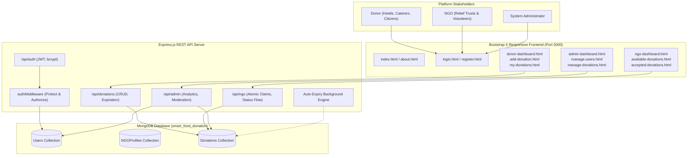

# Smart Food Donation & Management System
**MCA Backend Technology Mini Project**

A complete, fully functional, real-world full-stack web application developed to eliminate urban food waste by connecting hotels, banquet halls, restaurants, caterers, and individuals with verified NGOs and volunteers through a secure, role-based platform.

---

## 1. Project Overview & Problem Statement

### Real-World Problem
In metropolitan and urban regions, massive amounts of fresh, edible, and hygienic food are discarded daily by banquet halls, wedding parties, luxury hotels, hostels, and corporate cafeterias. At the same time, millions of disadvantaged people in shelter homes, slum communities, and orphanages face severe malnutrition and food insecurity. 

The core bottleneck is the **absence of an immediate, organized digital coordination channel** coupled with **strict time perishability** of cooked meals. Traditional food recovery is manual, ad-hoc, uncoordinated, and lacks accountability.

### Proposed Solution
The **Smart Food Donation & Management System** solves this crisis through a digitized, role-based ecosystem:
1. **Donors (Hotels/Caterers/Individuals)** can immediately list surplus meals with quantities, servings, preparation timestamps, and safe consumption deadlines.
2. **NGOs & Volunteers** browse live listings, claim donations atomically (preventing collision), and execute pickups using real-time status updates (Accepted &rarr; Pickup Scheduled &rarr; Collected &rarr; Delivered).
3. **Food Safety Automation** ensures meals past their safe consumption deadlines automatically transition to `Expired` and can never be accepted.
4. **Administrators** maintain complete platform oversight, monitor user registrations, verify NGO profiles, inspect audit logs, and track social impact metrics (meals delivered, beneficiaries reached).

---

## 2. Technology Stack

### Backend
- **Node.js**: Asynchronous event-driven runtime environment (v24 LTS / v18+)
- **Express.js**: Fast, minimalist REST API web framework
- **MongoDB**: NoSQL document database for scalable JSON-like document storage
- **Mongoose**: Object Data Modeling (ODM) library for schema enforcement and validation

### Security & Authentication
- **JSON Web Tokens (JWT)**: Stateless, role-based API authorization (`Authorization: Bearer <token>`)
- **bcrypt.js**: Cryptographic password hashing (10 salt rounds)
- **Role-Based Access Control (RBAC)**: Custom Express middlewares restricting routes to `donor`, `ngo`, or `admin`
- **Atomic Operations**: `findOneAndUpdate` concurrency locking ensuring only one NGO can accept a specific food donation

### Frontend
- **HTML5 & CSS3**: Clean, responsive layout with modern typography
- **Bootstrap 5.3**: Grid layout, responsive navigation, cards, tables, and modals
- **Bootstrap Icons**: Intuitive iconography across status badges and stat metrics
- **Vanilla JavaScript (ES6+)**: Fetch API client, session management, dynamic DOM rendering

### Developer Tools
- **VS Code**: Recommended IDE
- **Postman**: REST API test harness (`postman_collection.json` included)
- **MongoDB Compass**: Graphical database visualization tool

---

## 3. System Architecture & Workflow



---

## 4. User Roles & Capabilities

| Capability / Action | Donor | NGO | Admin |
| :--- | :---: | :---: | :---: |
| Self-Registration & JWT Login | Yes | Yes | Yes |
| Enter NGO Profile & Darpan Reg No. | No | Yes | Yes (View) |
| List Surplus Food Donation | Yes | No | Yes (View) |
| Specify Preparation Time & Safe Deadline | Yes | No | Yes (View) |
| View Personal Donation History | Yes | No | Yes (All) |
| Edit Pending Donation (Only if Available) | Yes | No | Yes |
| Cancel Pending Donation | Yes | No | Yes |
| Browse Available Food with Search & Filter | No | Yes | Yes |
| Claim / Accept Food Donation (Atomic) | No | Yes | No |
| Coordinate Pickup (View Donor Phone & Address) | No | Yes | Yes |
| Update Status (Scheduled &rarr; Collected &rarr; Delivered) | No | Yes | Yes |
| Platform Analytics (Aggregated Stats) | Personal | NGO Level | System Wide |
| Manage Registered Users & Roles | No | No | Yes |
| Delete Fraudulent / Spam Listings | No | No | Yes |

---

## 5. Donation Status Lifecycle & Bootstrap Badges

The system manages a rigorous 7-stage state machine:

| Status | Badge Color | Meaning & Trigger |
| :--- | :--- | :--- |
| **Available** | `badge-status status-available` (Green) | Freshly listed by donor; available for any verified NGO to claim. |
| **Accepted** | `badge-status status-accepted` (Blue) | An NGO has atomically claimed the donation. Locked against other NGOs. |
| **Pickup Scheduled** | `badge-status status-pickup-scheduled` (Light Blue) | NGO vehicle or volunteer courier has been assigned and dispatched. |
| **Collected** | `badge-status status-collected` (Yellow/Orange) | Food collected from donor and loaded into van / pantry. |
| **Delivered** | `badge-status status-delivered` (Purple) | Food safely distributed to community shelters and beneficiaries. |
| **Cancelled** | `badge-status status-cancelled` (Red) | Cancelled by donor prior to NGO acceptance. |
| **Expired** | `badge-status status-expired` (Gray) | Automatically triggered when `safeConsumptionDeadline < Date.now()`. |

---

## 6. MongoDB Database Schema Design

### A. User Schema (`User.js`)
```javascript
{
  name: { type: String, required: true, trim: true },
  email: { type: String, required: true, unique: true, lowercase: true },
  password: { type: String, required: true, select: false }, // Hashed bcrypt
  phone: { type: String, required: true, trim: true },
  role: { type: String, enum: ['donor', 'ngo', 'admin'], default: 'donor' },
  address: { type: String, required: true, trim: true },
  createdAt: { type: Date, default: Date.now }
}
```

### B. NGO Profile Schema (`NGOProfile.js`)
```javascript
{
  organizationName: { type: String, required: true },
  registrationNumber: { type: String, required: true, unique: true }, // Darpan / Trust Reg
  contactPerson: { type: String, required: true },
  email: { type: String, required: true },
  phone: { type: String, required: true },
  address: { type: String, required: true },
  userId: { type: mongoose.Schema.Types.ObjectId, ref: 'User', required: true, unique: true },
  verified: { type: Boolean, default: true },
  createdAt: { type: Date, default: Date.now }
}
```

### C. Donation Schema (`Donation.js`)
```javascript
{
  foodName: { type: String, required: true },
  category: { 
    type: String, 
    required: true, 
    enum: ['Cooked Meals', 'Raw Food/Groceries', 'Bakery Items', 'Packaged Food', 'Fruits & Vegetables', 'Dairy Products', 'Beverages', 'Other'] 
  },
  quantity: { type: String, required: true }, // e.g., '25 kg (70 plates)'
  servings: { type: Number, required: true, min: 1 }, // number of people fed
  preparationTime: { type: Date, required: true },
  safeConsumptionDeadline: { type: Date, required: true },
  pickupAddress: { type: String, required: true },
  contactNumber: { type: String, required: true },
  description: { type: String, default: '' },
  donorId: { type: mongoose.Schema.Types.ObjectId, ref: 'User', required: true },
  acceptedBy: { type: mongoose.Schema.Types.ObjectId, ref: 'User', default: null },
  status: { 
    type: String, 
    enum: ['Available', 'Accepted', 'Pickup Scheduled', 'Collected', 'Delivered', 'Cancelled', 'Expired'], 
    default: 'Available' 
  },
  statusNotes: { type: String, default: '' },
  statusHistory: [
    {
      status: { type: String, required: true },
      changedAt: { type: Date, default: Date.now },
      changedBy: { type: mongoose.Schema.Types.ObjectId, ref: 'User' },
      note: { type: String, default: '' }
    }
  ],
  createdAt: { type: Date, default: Date.now }
}
```

---

## 7. Complete REST API Specifications

### Authentication APIs (`/api/auth`)
| Method | Endpoint | Access | Description |
| :--- | :--- | :--- | :--- |
| `POST` | `/api/auth/register` | Public | Register Donor, NGO (with profile), or Admin |
| `POST` | `/api/auth/login` | Public | Verify credentials, return JWT & user details |
| `GET` | `/api/auth/me` | Private | Retrieve logged-in user profile & NGO data |
| `PUT` | `/api/auth/profile` | Private | Update user and organization contact details |

### Donation APIs (`/api/donations`)
| Method | Endpoint | Access | Description |
| :--- | :--- | :--- | :--- |
| `POST` | `/api/donations` | Private (Donor) | Create surplus food donation listing |
| `GET` | `/api/donations` | Public / Auth | List donations with status, category, & search |
| `GET` | `/api/donations/donor/my-donations` | Private (Donor) | Get donations listed by logged-in donor |
| `GET` | `/api/donations/donor/stats` | Private (Donor) | Get donor statistics & people fed count |
| `GET` | `/api/donations/:id` | Public / Auth | Get single donation with donor & NGO details |
| `PUT` | `/api/donations/:id` | Private (Donor) | Edit pending donation (only if Available) |
| `PUT` | `/api/donations/:id/cancel` | Private (Donor) | Cancel pending donation |
| `DELETE` | `/api/donations/:id` | Private (Donor/Admin) | Delete donation record |

### NGO APIs (`/api/ngo`)
| Method | Endpoint | Access | Description |
| :--- | :--- | :--- | :--- |
| `GET` | `/api/ngo/donations` | Private (NGO) | List available unexpired food listings |
| `PUT` | `/api/ngo/accept/:id` | Private (NGO) | **Atomic claim**: locks food to this NGO |
| `GET` | `/api/ngo/my-accepted` | Private (NGO) | List donations accepted by this NGO |
| `PUT` | `/api/ngo/status/:id` | Private (NGO) | Update pickup status (Scheduled, Collected, Delivered) |
| `GET` | `/api/ngo/stats` | Private (NGO) | Get NGO metrics: available, accepted, meals fed |

### Admin APIs (`/api/admin`)
| Method | Endpoint | Access | Description |
| :--- | :--- | :--- | :--- |
| `GET` | `/api/admin/dashboard` | Private (Admin) | System-wide statistics, counts, & categories |
| `GET` | `/api/admin/users` | Private (Admin) | List all users with role filter & search |
| `DELETE` | `/api/admin/users/:id` | Private (Admin) | Delete user and cascade associated records |
| `GET` | `/api/admin/donations` | Private (Admin) | Full system donation surveillance |
| `DELETE` | `/api/admin/donations/:id` | Private (Admin) | Delete invalid or spam donation listing |
| `PUT` | `/api/admin/donations/:id/status`| Private (Admin) | Administrative status adjustment |

---

## 8. Step-by-Step Running Instructions (Windows & VS Code)

### Step 1: Open Project in VS Code
1. Launch **Visual Studio Code**.
2. Go to **File &rarr; Open Folder...** and select `backend mini project`.
3. Open a terminal inside VS Code using <kbd>Ctrl</kbd> + <kbd>`</kbd> (Backtick) or **Terminal &rarr; New Terminal** (PowerShell).

### Step 2: Install Node.js Dependencies
In the terminal, run:
```powershell
cd backend
npm.cmd install
```
*(If you run from the root workspace directory, you can also run `npm.cmd install`)*

### Step 3: Configure and Start MongoDB
Ensure MongoDB is installed and running on default port `27017`.
- **Option A (If MongoDB Windows Service is installed)**: Ensure service `MongoDB` is running.
- **Option B (Run MongoDB directly from binary)**:
```powershell
& "C:\Program Files\MongoDB\Server\8.2\bin\mongod.exe" --dbpath ".\data\db" --port 27017
```

### Step 4: Configure the `.env` File
A pre-configured `.env` file is included in `backend/.env`.
```env
PORT=5000
NODE_ENV=development
MONGO_URI=mongodb://127.0.0.1:27017/smart_food_donation
JWT_SECRET=smart_food_donation_super_secret_jwt_key_2026_mca_project
JWT_EXPIRE=30d
```

### Step 5: Seed Demo Database (Instant 1-Click Evaluation Data)
Run the automated seed script to populate realistic sample data:
```powershell
node backend/seed.js
```
This generates the Admin account, 3 Donor organizations, 2 registered NGOs, and 8 realistic food donations with full lifecycles.

### Step 6: Start Backend Server
```powershell
node backend/server.js
```
Output will display:
```
====================================================
 Smart Food Donation & Management System Backend 
 Server running in development mode
 Local URL: http://localhost:5000
 Static Frontend: ...\frontend
====================================================
[MongoDB Connected]: 127.0.0.1/smart_food_donation
```

### Step 7: Open the Frontend Application
Simply open your web browser (Chrome, Edge, Firefox) and navigate to:
```
http://localhost:5000
```
The Express backend automatically serves the complete responsive frontend!

---

## 9. Demo Login Credentials (Ready to Test)

The login page (`login.html`) includes **1-click quick credentials buttons** for easy testing:

| Role | Email Address | Password | Name / Entity |
| :--- | :--- | :--- | :--- |
| **Admin** | `admin@smartfood.org` | `admin123` | System Administrator |
| **Donor** | `tajhotel@gmail.com` | `donor123` | Taj Residency Banquet & Catering |
| **Donor** | `annapurna.caterers@gmail.com` | `donor123` | Annapurna Caterers & Events |
| **Donor** | `rahul.sharma@gmail.com` | `donor123` | Rahul Sharma (Community Donor) |
| **NGO** | `contact@annakshetra.org` | `ngo123` | Anna Kshetra Relief Foundation |
| **NGO** | `hope@robinhoodarmy.org` | `ngo123` | Robin Hood Army Volunteers |

---

## 10. Testing Donor, NGO, and Admin Functionalities

### Test Case 1: Donor Journey
1. Open `http://localhost:5000/login.html` and click **Donor: tajhotel@gmail.com**.
2. Click **Sign In** &rarr; Redirects to **Donor Dashboard** (`donor-dashboard.html`).
3. Click **Add Food Donation** (`add-donation.html`).
4. Enter:
   - Food Name: `Dal Makhani & Naan Bread`
   - Category: `Cooked Meals`
   - Quantity: `15 kg`
   - Servings: `40`
   - Safe Deadline: Set a future time (e.g., 6 hours from now).
   - Pickup Address: `Taj Kitchen Back Door`
   - Click **List Food Donation Now**.
5. You are redirected to **My Donations** (`my-donations.html`). The new donation appears as `Available` with a countdown timer.
6. Click **Edit** (Pencil icon) to modify details or **Cancel** (X icon) to cancel.

### Test Case 2: NGO Journey & Concurrency Collision Test
1. Log out and log in as NGO: `contact@annakshetra.org` / `ngo123`.
2. Go to **Available Food** (`available-donations.html`).
3. Find the donation listed above.
4. Click **Accept & Pickup Food** &rarr; Enter coordination note (e.g. `Van KA-01-AB-1234 dispatched`) &rarr; Click **Confirm Acceptance**.
5. The donation status updates to `Accepted` and moves to **Accepted Pickups** (`accepted-donations.html`).
6. **Collision Check**: Open an incognito window and log in as the other NGO (`hope@robinhoodarmy.org`). The donation is no longer in the Available list! If attempted via API concurrently, the API rejects it with `409 Conflict`.
7. Back on `accepted-donations.html`:
   - Click **Schedule** &rarr; transitions to `Pickup Scheduled`.
   - Click **Mark Collected** &rarr; transitions to `Collected`.
   - Click **Mark Delivered** &rarr; transitions to `Delivered`.
   - The total meals distributed counter on the NGO Dashboard updates automatically.

### Test Case 3: Admin Journey
1. Log in as Admin: `admin@smartfood.org` / `admin123`.
2. View **Admin Dashboard** (`admin-dashboard.html`): View real-time aggregated counts for users, donors, NGOs, donations, and category distributions.
3. Open **Manage Users** (`manage-users.html`): Filter by role (`donor`, `ngo`, `admin`), search by name/email, inspect NGO Darpan registration numbers, or delete any account.
4. Open **Manage Donations** (`manage-donations.html`): View the system-wide donation stream, inspect lifecycle audit histories, or delete fraudulent listings.

---

## 11. Testing APIs Using Postman

1. Open **Postman**.
2. Click **Import** in the upper left corner.
3. Select the `postman_collection.json` file located in the project root directory.
4. The collection **"Smart Food Donation & Management System API"** will be imported with pre-configured requests grouped by:
   - `1. Authentication`
   - `2. Donor Operations`
   - `3. NGO Operations`
   - `4. Admin Operations`
5. Run **Login as Admin** or **Login as Donor**. Copy the returned `token` into the collection variable `adminToken` or `donorToken` to execute authenticated endpoints.

---

## 12. Automated Verification Suite

To verify all backend API operations, concurrency locking, and status transitions in one command:
```powershell
node test_api.js
```
Output:
```
--- STARTING COMPREHENSIVE BACKEND API TESTS ---
1. Health Check: 200 PASS
2. Admin Login: 200 PASS
3. Donor Login: 200 PASS
4. NGO 1 Login: 200 PASS
5. NGO 2 Login: 200 PASS
6. Donor Create Donation: 201 PASS
7. Donor Stats API: 200 Total donations: 4
8. NGO Available Donations: 200 Count: 4
9. NGO 1 Accept Donation: 200 PASS
10. Collision Prevention (NGO 2 blocked): PASS (Properly rejected with 409 Conflict)
11. Status -> Pickup Scheduled: 200 PASS
12. Status -> Collected: 200 PASS
13. Status -> Delivered: 200 PASS
14. Admin Dashboard Stats: 200
15. Admin Users List: 200
--- ALL API TESTS COMPLETED SUCCESSFULLY! ---
```

---

## 13. Project Folder Structure

```
backend mini project/
│
├── backend/
│   ├── config/
│   │   └── db.js                       # Mongoose MongoDB connection module
│   ├── models/
│   │   ├── User.js                     # User Schema (Donor, NGO, Admin with bcrypt)
│   │   ├── NGOProfile.js               # NGO Profile Schema (Darpan Reg No., verification)
│   │   └── Donation.js                 # Donation Schema (Categories, Servings, Milestones)
│   ├── controllers/
│   │   ├── authController.js           # Register, Login, Me, Profile Controllers
│   │   ├── donationController.js       # CRUD Donations, Donor Stats, Expiration
│   │   ├── ngoController.js            # Available Food, Atomic Accept, Status Updater
│   │   └── adminController.js          # Aggregated Metrics, User & Donation Moderation
│   ├── routes/
│   │   ├── authRoutes.js               # Authentication endpoints
│   │   ├── donationRoutes.js           # Donor donation endpoints
│   │   ├── ngoRoutes.js                # NGO claim & status endpoints
│   │   └── adminRoutes.js              # Admin management endpoints
│   ├── middleware/
│   │   ├── authMiddleware.js           # JWT verification & role authorization (RBAC)
│   │   └── errorMiddleware.js          # Global 404 and exception handler
│   ├── utils/
│   │   └── expireDonations.js          # Auto-expiration engine for safe consumption
│   ├── seed.js                         # Database seeder with realistic demo data
│   ├── server.js                       # Main Express application entry point
│   ├── package.json                    # Backend dependencies & run scripts
│   ├── .env                            # Active environment variables
│   └── .env.example                    # Sample environment template
│
├── frontend/
│   ├── index.html                      # Landing page with problem/solution & workflow
│   ├── about.html                      # About us, food safety, and MCA project details
│   ├── login.html                      # Login with 1-click evaluation demo buttons
│   ├── register.html                   # Role-based registration (Donor / NGO / Admin)
│   ├── donor-dashboard.html            # Donor dashboard with real MongoDB statistics
│   ├── add-donation.html               # Add donation form with food safety deadlines
│   ├── my-donations.html               # Donor's donation tracking, edit & cancel actions
│   ├── ngo-dashboard.html              # NGO operations dashboard & metrics
│   ├── available-donations.html        # Available surplus food search & claim cards
│   ├── accepted-donations.html         # Accepted pickups & status milestone progression
│   ├── admin-dashboard.html            # System administrator dashboard & analytics
│   ├── manage-users.html               # User management table & moderation
│   ├── manage-donations.html           # Full donation audit & deletion
│   ├── css/
│   │   └── style.css                   # Theme stylesheet (Green/White clean aesthetic)
│   └── js/
│       ├── api.js                      # Centralized Fetch API client
│       ├── auth.js                     # Token session manager & dynamic navbar builder
│       ├── main.js                     # Toasts, badge formatters & date utilities
│       ├── donor.js                    # Donor module logic & modals
│       ├── ngo.js                      # NGO module logic & atomic accept
│       └── admin.js                    # Admin module logic & analytics charts
│
├── postman_collection.json             # Ready-to-import Postman Collection v2.1
├── test_api.js                         # Automated verification test script
├── package.json                        # Root workspace convenience package
└── README.md                           # Comprehensive documentation & report
```

---

## 14. Academic Mini Project Highlights (For Viva / Evaluation)

1. **Robust MVC Architecture**: Clear separation of Concerns between Models, Views (static HTML5), Controllers, and Middleware.
2. **True MongoDB Persistence**: All statistics, user accounts, and status transitions interact directly with MongoDB; zero hardcoded mock values.
3. **Atomic Concurrency Control**: Food acceptance uses atomic MongoDB filters (`status: 'Available'`, `safeConsumptionDeadline: { $gt: now }`) to eliminate race conditions between multiple NGOs.
4. **Food Safety Engine**: Automatic background verification ensuring perishable meals past their consumption deadline are flagged as `Expired`.
5. **Role-Based Access Control (RBAC)**: Enforced via modular Express middlewares (`protect`, `authorize('donor')`, `authorize('ngo')`, `authorize('admin')`).
6. **Password Security**: Passwords salted and hashed with `bcryptjs` before persisting; excluded from Mongoose queries by default.
